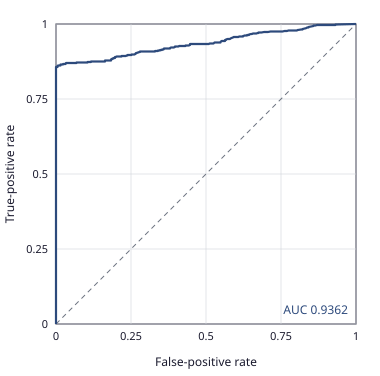

# Tamper detector: evaluation

<!-- Generated by scripts/evaluate_tamper_detector.py. Do not edit by hand:
     tests/test_evaluation.py fails if this file differs from its output. -->

The README quotes **93.33%**, the shipped model's accuracy on one held-out
split of 60 shares (`app/ai_security/models/tamper_detector_metrics.json`).
That remains the figure *for the shipped model*. One split of 60 says little
about how far such a figure moves, so this page estimates the spread.

## Method

- The dataset is the training script's own: `build_dataset()` in
  `scripts/train_tamper_detector.py`, 240 feature vectors of 96 × 96
  shares, 120 clean and 120 tampered, the tampered ones
  spread over seven attacks at strengths 0.18-0.55 (block 18, noise 17, blur 17, brightness 17, crop 17, scratch 17, jpeg 17).
- Stratified 5-fold cross-validation (`shuffle=True`), repeated 5 times
  with seeds 42-46: 25 folds, each sample
  predicted once per repeat.
- A fresh `RandomForestClassifier` is fitted inside every fold with the shipped
  hyperparameters (`MODEL_PARAMS`: `n_estimators=45`, `max_depth=10`, `min_samples_leaf=2`, `random_state=7`, `class_weight='balanced'`, `n_jobs=1`).
- The shipped model is not refitted or re-exported. The script checks the
  sha256 of `tamper_detector.joblib` and `tamper_detector.onnx` before and
  after, and fails if either changed. Only the size table below uses it.
- Threshold 0.5 throughout, as in the app.

## Results

| Measure | Mean ± standard deviation over the 25 folds |
| --- | --- |
| Accuracy | 92.42% ± 3.34 |
| Precision (tampered) | 98.51% ± 2.23 |
| Recall (tampered) | 86.17% ± 6.33 |
| ROC-AUC | 0.9383 ± 0.0294 |

The shipped model's 93.33% lies inside two standard deviations of the
cross-validated mean, so it is a typical draw, not a lucky split.

### Recall by attack

Pooled over all 25 folds: of the times a share damaged by each attack was in
a test fold, how often the classifier called it tampered.

| Attack | Detected | Recall |
| --- | --- | --- |
| block | 90 of 90 | 100.00% |
| blur | 85 of 85 | 100.00% |
| brightness | 85 of 85 | 100.00% |
| crop | 85 of 85 | 100.00% |
| jpeg | 85 of 85 | 100.00% |
| scratch | 83 of 85 | 97.65% |
| noise | 4 of 85 | 4.71% |
| *clean shares wrongly flagged* | 8 of 600 | false-positive rate 1.33% |

**What it misses: `noise`.** Random-noise injection is detected
4.71% of the time, little better than the false-positive rate. Adding
random noise to a share that is itself uniform random noise leaves every
statistic the classifier measures where it was, so no threshold on these
features can see it. That is why the HMAC exists: it catches every change,
noise included, and the classifier is the second opinion that localises
the damage and explains its verdict. Of the other attacks, the classifier missed only scratch 2 of 85 times.

### Confusion matrix

Summed over the 25 folds (1200 predictions: each of the
240 samples once per repeat).

| | Predicted clean | Predicted tampered |
| --- | --- | --- |
| **Clean** | 592 | 8 |
| **Tampered** | 83 | 517 |

### ROC curve

Out-of-fold scores pooled across all repeats; area 0.9362.



## The shipped model on shares of other sizes

The dataset above is 96 × 96 only, as was the shipped model's training data.
Chat shares are as large as the image the sender picked, up to 1,200 px on
the long edge, so this asks the shipped model about 200 clean random
shares at each of several sizes. Every one of them is untampered, so every
"tampered" verdict is a false positive.

| Share size | Clean shares flagged as tampered | Mean P(tampered) |
| --- | --- | --- |
| 64 × 64 | 200 of 200 (100.00%) | 0.659 |
| 80 × 80 | 116 of 200 (58.00%) | 0.515 |
| 96 × 96 | 5 of 200 (2.50%) | 0.165 |
| 128 × 128 | 0 of 200 (0.00%) | 0.099 |
| 256 × 256 | 0 of 200 (0.00%) | 0.039 |
| 512 × 512 | 0 of 200 (0.00%) | 0.020 |

**Below about 100 px a clean share is often called tampered.** The likely
cause is sample size: with fewer pixels, a random image's measured entropy
and histogram depart further from the ideal, and the model learned what
"clean" looks like at 96 × 96 only. From 128 px up, no clean share in this
sample was flagged. In the chat this means a very small image
(an icon, a sticker) can show *Tampering detected* while its HMAC matches
exactly; the HMAC row is the one to believe. Fixing it means training on
varied sizes, which is a retraining of the shipped model and was out of
scope for this evaluation.

## Reproducing this page

```bash
python scripts/evaluate_tamper_detector.py          # rewrites this page and the SVG
python scripts/evaluate_tamper_detector.py --check  # exits 1 if they are stale
```

It takes well under two minutes, and `tests/test_evaluation.py` runs it in
the normal suite, so CI fails if this page drifts from what the code produces.
